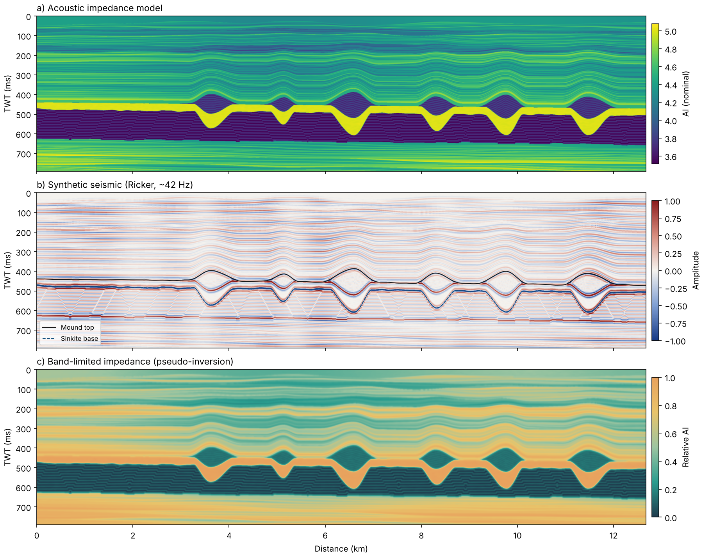

# Synthetic seismic model of sinkite mounds



A small Python script that builds a 2D acoustic impedance model of a sinkite and floatite mound field, turns it into synthetic seismic with a convolutional model, and makes a smoothed impedance section that behaves roughly like a band-limited inversion result.

I wrote it to illustrate the kind of geometry I work on in my PhD at the University of Manchester, and as a quick way to see how these bodies could look in seismic amplitude compared with impedance. It is a cartoon for illustration and teaching, not a calibrated model of any field, and it uses no real survey data.

## Background

Sinkites are km-scale bodies of dense sand in the northern North Sea that appear to have sunk into lighter, ooze-rich sediment below them, while the displaced ooze (floatites) was pushed up into the mound cores. The result is stratigraphic inversion: younger sand sits below older sediment. The idea is described in Rudjord and Huuse (2025), see the reference below.

## What the model includes

- Layered overburden that drapes over the mounds, with the drape dying out upwards
- Floatites: ooze rafts in the mound cores, broken into slightly tilted blocks
- Sinkites: sand bodies that sank into the ooze, giving downward-bulging keels
- Polygonal faults in the ooze-rich interval, inclined and with small throws
- A layered deeper section

## How it works

1. Build an acoustic impedance (AI) section on a regular grid. Units are nominal, with 1 sample = 1 ms TWT and 1 trace = 4 m.
2. Compute normal-incidence reflectivity at every sample: r = (Z₂ − Z₁) / (Z₂ + Z₁).
3. Convolve each trace with a zero-phase Ricker wavelet, about 42 Hz at 1 ms sampling.
4. Smooth the AI to mimic the resolution you would get from a post-stack inversion.

## Run it

```bash
pip install -r requirements.txt

python synthetic_sinkites.py figure                  # three-panel figure
python synthetic_sinkites.py banner --style dark     # 1584 x 396 banner image
```

Add `--seed 3` (or any number) for a different random realisation, and `-o path.png` to choose the output file.

## Limitations

- 1D convolution per trace at normal incidence, so no wave propagation, diffractions or AVO effects
- Impedance values are nominal, not taken from well logs
- The "inversion" is just smoothing plus a little noise, with no wavelet estimation or low-frequency model

## Reference

Rudjord, J. E. and Huuse, M. (2025). Km-scale mounds and sinkites formed by buoyancy driven stratigraphic inversion. *Communications Earth & Environment*. https://doi.org/10.1038/s43247-025-02398-8

## Licence

MIT, see [LICENSE](LICENSE).

---

Gasim Mammadov · PhD candidate, The University of Manchester · [LinkedIn](https://www.linkedin.com/in/gasiim-mammadov)
